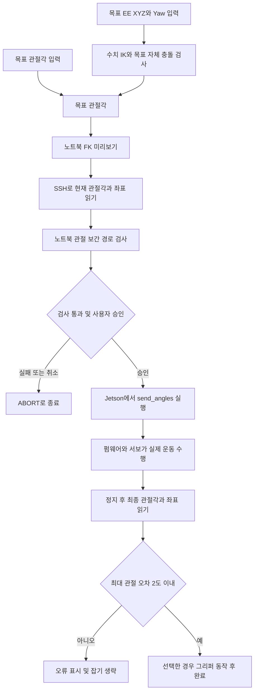

# myCobot 280 JN GUI — FK·IK·이동·자체 충돌 구현 정리

작성일: 2026-11-04, 한국 시간  
대상: myCobot 280 Jetson Nano, 기본 적응형 그리퍼와 카메라 장착  
범위: 이 대화에서 작성한 코드·설정·실측 기록을 기준으로 한 구현 설명과 인계 문서

## 1. 결과와 가장 중요한 전제

노트북에서 목표 관절각 또는 목표 EE 좌표를 입력하면, 노트북이 모델 계산과 충돌 검사를 수행하고 Jetson에 목표 관절각을 보낸다. Jetson은 `pymycobot`으로 로봇 컨트롤러에 위치 명령을 전달한다.

**현재 FK는 수정 DH 행렬 여섯 개를 곱한다. IK는 같은 FK를 반복 평가하는 수치 최적화다.** 각 행은 `Rx(α) Tx(a) Rz(q + θ₀) Tz(d)` 순서로 계산한다. 길이는 m, 내부 각도는 rad 단위다.

초기 DH 적용에서 실제 수직 자세와 표시가 달라 공식 JN URDF를 기준 모델로 삼았다. 현재 수정 DH는 제조사의 myCobot 280 축 배치·각도 오프셋에 JN 모델의 길이를 적용한다. J1과 J2 사이 축 방향 −1 mm를 d₁에 포함하고, 링크 표시·충돌 검사에 넘기는 J1 위치는 1 mm 복원한다. 임의 관절 자세 1,000개에서 여섯 프레임을 기존 URDF 계산과 대조해 수치 정밀도 범위에서 일치함을 확인했다.

현재 구현의 합격 판정은 설정된 모델·관절 제한·샘플 경로를 통과했다는 뜻이다. 실제 환경 전체의 충돌 안전성이나 손끝 도달 정확도를 보증하는 것은 아니다.

## 2. 개발 과정과 현재 구조

1. 처음에는 Jetson에서 현재·목표 자세를 그리는 GUI를 구현했다.
2. 로봇 통신과 시각화 부담을 분리하기 위해 GUI를 노트북으로 옮겼다.
3. Jetson에는 단발성 SSH 브리지를 두고, 시작·완료 관절값만 읽도록 바꿨다.
4. 공식 JN URDF 기반 FK로 현재·목표 링크를 그리도록 수정했다.
5. 기본 그리퍼·카메라의 충돌 형상을 추가하고 공식 CAD·장착 변환을 대조했다.
6. 닫힌 손끝의 테이블 접촉으로 잠정 Z 보정과 추가 자세 검증을 수행했다.
7. 노트북 수치 IK를 추가해 EE 좌표도 목표 관절각으로 변환하도록 연결했다.
8. 수동 그리퍼 동작, 도착 후 잡기, 좌표 표·로그, 목표 초기화를 추가했다.
9. JN 프레임과 동등한 수정 DH 계산으로 전환했다.

노트북은 UI·FK·IK·충돌·경로 검사를 담당한다. Jetson은 시리얼 연결·명령 송신·완료 상태 확인을 담당한다. 별도 네트워크 서버 대신 SSH의 표준입출력으로 한 줄 단위 JSON을 교환한다.

관절 제한·충돌 검사는 노트북에서 수행한다. 브리지의 기본 검증은 목표6개가 유한한 값인지, 속도가1~100인지 등에 한정된다. 브리지를 GUI 밖에서 직접 호출하면 노트북의 경로 검사를 자동으로 거치는 것은 아니다.



## 3. 주요 파일과 실행 방법

프로젝트 루트:

```text
C:\programming\python workspace\ARCLAB\UROP2
```

| 파일 | 역할 |
|---|---|
| `scripts/laptop_robot_gui.py` | 현재 GUI, SSH 스레드, 입력·검사 상태, 좌표 표와 로그 |
| `mycobot_id/kinematics.py` | 수정 DH FK, 관절 제한, 형상, 자체 충돌·경로 검사 |
| `mycobot_id/inverse_kinematics.py` | 닫힌 손끝 중점의 수치 IK |
| `scripts/robot_bridge.py` | Jetson의 시리얼·JSON 브리지 |
| `configs/jetson.json` | SSH 호스트·원격 루트·포트·baud |
| `configs/robot_pose_gui.json` | 액세서리 형상·TCP·테이블 Z 보정 |
| `.jetson/state.json` | GUI가 사용할 배포 릴리스 위치 |
| `tools/jetson.py` | 연결 확인·새 릴리스 배포 |
| `analysis/floor_workspace.py` | 바닥 작업공간 수치 탐색 |
| `tools/inspect_camera_model.py` | 카메라 DAE·STEP·장착 변환 분석 |
| `tools/inspect_gripper_contact.py` | 손끝 메시·장착 변환·테이블 접촉 분석 |
| `assets/official/` | 공식 CAD·URDF·제어 예제와 분석 결과 |
| `data/calibration/` | 바닥 접촉 자세와 검증 기록 |
| `reports/floor_workspace.json` | 바닥 도달 범위 탐색 결과 |
| `reports/gui/pose_*.jsonl` | 실행별 좌표·명령·결과 로그 |
| `tests/` | FK·IK·충돌·브리지 테스트 |

초기 Jetson용 `scripts/robot_pose_gui.py`도 소스에 남아 있지만 현재 진입점은 `laptop_robot_gui.py`다.

### 노트북 실행

가상환경이 활성화된 PowerShell:

```powershell
cd "C:\programming\python workspace\ARCLAB\UROP2"
python scripts\laptop_robot_gui.py --enable-motion
```

가상환경을 활성화하지 않은 경우:

```powershell
.\.venv\Scripts\python.exe scripts\laptop_robot_gui.py --enable-motion
```

NumPy·SciPy·Matplotlib·Tkinter와 SSH 클라이언트가 필요하다. 분석용 의존성은 `requirements-analysis.txt`에 있다. CAD 판독용 `cadquery-ocp-novtk`는 원본 분석을 위한 개발 의존성이며 GUI 실행에는 필요하지 않다.

Jetson에서 확인한 환경은 Python 3.8.10, `pymycobot 3.5.3`이다. 브리지는 `from pymycobot.mycobot import MyCobot`을 사용한다. 시리얼은 `/dev/ttyTHS1`, baud는 `1000000`이다.

작성 시 `.jetson/state.json`에 기록된 릴리스:

```text
/home/er/workspace/urop2-identification/releases/20261104T094720Z_e00c0f
```

이후 실행·배포에서는 위 경로를 고정하기보다 상태 파일을 확인한다. 노트북 GUI·기구학만 바뀌고 브리지 프로토콜이 같으면 Jetson 재배포는 필요 없다.

## 4. 좌표계·단위와 EE의 의미

| 항목 | 기준 |
|---|---|
| 관절 입력 | `get_angles()`·`send_angles()`와 같은 영점 기준 절대각, 단위 ° |
| FK 내부 | 길이 m, 각도 rad |
| EE XYZ 입력 | 테이블 Z=0을 반영한 모델 좌표, 단위 mm |
| Yaw 입력 | 테이블 +Z축 주위 회전, 단위 ° |
| 로봇 좌표 표시 | 펌웨어 `get_coords()`의 `[X,Y,Z,Rx,Ry,Rz]`, mm와 ° |
| 모델 플랜지 좌표 | JN 베이스에서 마지막 플랜지까지의 수정 DH FK 위치 |
| 손끝 중점 추정 | 완전히 닫힌 양쪽 손끝의 중점. 현재 EE 입력·IK의 TCP |

관절값은 증분이 아니다. 현재 J1=30°에서 목표40°를 입력하면 목표40°를 보내며, 추가40° 회전시키는 명령이 아니다.

로봇 좌표는 펌웨어의 도구·기준 설정을 따른다. 모델 좌표와 완전히 정합시킨 상태가 아니며 이전 측정에서 플랜지 Z에 약15~17 mm 차이가 있었다. `get_coords()` 값을 그리퍼 손끝 위치로 바로 해석하지 않는다.

JN 모델은 첫 관절 원점 변환에 Z=157.56 mm를 사용해 공식 JN 베이스 오프셋을 반영한다. 이 수치를 케이스 두께라고 해석하거나 모델 원점이 물리 테이블 면과 정확히 같다고 단정할 수는 없다. 테이블 기준은 별도 접촉 보정으로 설정했다. Jetson 케이스의 상자 충돌 형상은 없다.

## 5. FK 계산

`forward_kinematics()`는 각 관절의 고정 변환과 로컬 Z축 회전을 누적한다.

```text
T_origin_i = Translation(x_i,y_i,z_i) · Rz(yaw_i) · Ry(pitch_i) · Rx(roll_i)
T_i        = T_(i-1) · T_origin_i · Rz(q_i)
T_flange   = T_6
```

모든 관절은 고정 원점 변환을 적용한 뒤의 로컬 +Z축으로 회전한다.

| 관절 | origin XYZ (m) | origin RPY (rad) |
|---|---|---|
| J1 | (0, 0, 0.15756) | (0, 0, 0) |
| J2 | (0, 0, −0.001) | (0, π/2, −π/2) |
| J3 | (−0.1104, 0, 0) | (0, 0, 0) |
| J4 | (−0.096, 0, 0.06462) | (0, 0, −π/2) |
| J5 | (0, −0.07318, 0) | (π/2, −π/2, 0) |
| J6 | (0, 0.0456, 0) | (−π/2, 0, 0) |

FK 결과에는 단계별 변환행렬, 시작점 포함7개 원점 위치, 액세서리 보조점과 충돌용 상자가 들어 있다. 링크 표시는 원점 간 중심선을 사용하고, 충돌 검사는 아래의 캡슐·상자 모델을 사용한다.

플랜지에 고정된 TCP의 위치:

```text
p_tip_model = R_flange · p_tip_in_flange + p_flange
p_tip_table = p_tip_model + (0,0,table_z_offset)
```

이 계산은 노트북 모델 변환이며 펌웨어의 원점·영점 설정을 변경하지 않는다.

## 6. 닫힌 손끝과 테이블 Z 보정

공식 JN 그리퍼 예제는 개방값0을 모델각−0.74 rad, 개방값100을0.15 rad로 매핑한다. 공식 URDF의 장착·연결 변환과 양쪽 손끝 DAE를 합성해 닫힌 손끝의 끝면 중점을 추정했다.

```text
closed_tip_midpoint_flange_m =
    (−0.000607416245, +0.015589790247, +0.122543994734)

model_to_table_z_offset_m = −0.003907428296
```

CAD의 좌표 원점을 손끝 중심으로 간주한 것이 아니다. 손끝 형상, 모델의 닫힘각, 플랜지 장착 변환을 적용한 결과다. 끝면 메시를 이용한 추정으로 개체의 고무 패드·조립 오차까지 보증하지 않는다.

사용자가 그리퍼를 완전히 닫아 양쪽 손끝을 Jetson 케이스가 놓인 동일 테이블에 접촉시킨 뒤 각도를 읽었다.

| 기록 | J1 | J2 | J3 | J4 | J5 | J6 | 보정 후 손끝 Z |
|---|---:|---:|---:|---:|---:|---:|---:|
| 1: 보정에 사용 | −55.01 | −33.48 | −109.86 | 53.87 | 1.31 | −33.48 | 0 mm, 보정 정의상 |
| 2: 추가 검증 | 36.82 | −54.84 | −66.53 | 33.48 | −1.31 | −58.35 | 약0.94 mm |

첫 기록으로 Z 이동−3.907428 mm를 구하고 두 번째 기록에서는 재조정하지 않았다. **단일 접촉 기반 잠정 Z 보정이며 전체 작업공간의1 mm 정확도를 검증한 것은 아니다.** XY·테이블 기울기·관절 영점·백래시·하중 처짐은 보정하지 않았다.

모델 플랜지 표, 손끝 표와3D 장면은 테이블 Z 보정을 사용한다. 원래 FK값·로봇 좌표는 로그에 따로 남는다. 관절 명령과 로봇 펌웨어 설정은 바꾸지 않는다.

## 7. 관절각 입력에서 실제 이동까지

1. 사용자가 J1~J6 절대 목표각을 입력한다.
2. FK로 목표 자세를 미리 그린다. 입력만으로는 움직이지 않는다.
3. `현재 읽기 + 경로 검사`를 누르면 노트북이 SSH 자식 프로세스로 Jetson의 `robot_bridge.py transaction`을 실행한다.
4. 실행 인자로 목표6각도와 속도를 전달하지만 이 시점에는 위치 명령을 보내지 않는다.
5. Jetson이 현재 관절각·좌표를 한 번씩 읽어 `current` JSON을 반환한다.
6. 같은 SSH 연결을 유지한 채 Jetson은 표준입력의 승인 신호를 기다린다.
7. 노트북이 현재각·목표각의 관절 제한과 가정한 보간 경로의 자체 충돌을 검사한다.
8. 통과 후 사용자가 이동 확인창을 승인하면 같은 연결로 `PROCEED` JSON을 보낸다. 취소 시 `ABORT`로 종료한다.
9. Jetson이 다음 위치 명령 한 묶음을 보낸다.

```python
robot.send_angles(target_angles, speed)
```

10. 실제 운동은 펌웨어·서보가 수행한다. 노트북은 모터 PWM·전류·토크·서보 PID를 직접 제어하지 않는다.
11. Jetson이0.25초 후부터 약0.1초 간격으로 `is_moving()`을 조회한다. 기본 제한시간은60초다.
12. 정지 응답 후 최종 관절각·좌표를 한 번씩 읽어 `final`을 보낸다.
13. 최대 관절 오차가2° 초과면 목표 미도달 오류와 함께 잡기를 생략한다.2° 이내면 선택한 그리퍼 동작 후 `done`을 보낸다.

```text
joint_error_max = max(abs(q_final − q_target))
```

### 이 방식의 정확한 의미

- 속도는 API 정수1~100, 기본20이다.20을20°/s로 해석하지 않는다.
- Python이 검사한 중간 보간점들을 차례로 보내지 않는다. 최종 목표각을 한 번 전송한다.
- 실제 가감속·관절 동기화·중간 궤적은 펌웨어 구현·설정에 달려 있다. 검사한 선형 관절 보간과의 일치는 검증하지 않았다.
- 외부 Cartesian 폐루프, MPPI, DOB 등은 이 GUI에 들어 있지 않다.
- 관절 오차2° 이내는 손끝이 목표에1 mm 이내로 도착했다는 뜻이 아니다.
- 검사 시작각을 읽은 뒤 승인 전에 손으로 자세를 바꾸면 검사가 오래된 시작값을 사용한다. 승인 직전 재조회는 없다.
- 목표 변경·취소 시 대기 중 검사를 무효화한다.
- 시작 목표와 `전체 목표 초기화` 값은 `[0,0,0,0,0,-45]°`다. 초기화 버튼은 목표만 설정하고 이동하지 않는다.

## 8. EE 좌표 입력과 수치 IK

지원 목표는 **완전 닫힘 손끝 중점 XYZ + 수직 아래 방향 + Yaw**다. 임의 Roll·Pitch를 입력하는6차원 자세 IK나 실제 열린 손끝 TCP가 아니다.

```text
입력 XYZ: 테이블 Z 보정 기준 [mm]
입력 Yaw: 테이블 +Z축 회전 [deg]
R_target = Rz(Yaw) · diag(1,−1,−1)
```

플랜지 +Z는 아래, 플랜지 +X 방향은 Yaw로 정한다. Yaw는 J6 자체 각도가 아니며 카메라 영상 물체각·그리퍼 개폐선과 자동으로 일치하지 않는다.

### 계산 절차

1. 유한한 숫자·보정 설정을 확인하고 Z<0을 거부한다.
2. mm·°를 내부 단위로 변환하고 테이블 Z 이동을 역으로 제거해 모델 기준 목표 위치를 구한다.
3. `scipy.optimize.least_squares`로6관절을 계산한다.
4. 오차벡터는 위치3성분과 회전3성분이다.

```text
e_pos = FK(q)의 손끝 위치 − 목표 위치 [m]
e_rot = rotation_vector(R_target.T · R_flange) [rad]
residual = [e_pos, 0.1 · e_rot]
```

`0.1`은 위치·회전의 수치적 가중치이지 물리적인 오차 보증값이 아니다.

5. 관절 제한을 최적화 경계로 적용한다. 초기값당 `max_nfev=180`, `ftol/xtol/gtol=1e-9`를 사용한다.
6. 마지막으로 읽은 현재각(없으면0각), 접촉 자세2개, 고정 난수 seed280의9개 자세를 합쳐12개 초기값을 시도한다.
7. FK 재평가 위치 오차0.5 mm 이하·방향 오차1° 이하·목표 자세 자체 충돌 없음인 후보를 남긴다.
8. 기준 seed와 일반 유클리드 관절각 거리(rad)가 가장 가까운 후보를 고른다. 최단 시간·Cartesian 최단 경로 최적화는 아니다.
9. 결과를 관절 목표란에 넣고 FK 미리보기를 한다. **IK 계산만으로 로봇을 움직이지 않는다.**
10. 이후 현재각을 새로 읽고 관절 입력과 동일한 경로 검사·사용자 승인·`send_angles()`를 수행한다.

IK는 별도 스레드로 계산하고 입력이 달라지면 오래된 계산 결과·검사를 무효화한다.

수치 탐색 실패는 수학적 해 부재의 증명이 아니다. 목표 IK가 있어도 경로가 충돌하면 이동을 거부한다. 다른 IK 분기를 자동 선택해 경로를 재계획하는 기능은 없다.

## 9. 적용한 관절 제한

| 관절 | 최솟값 | 최댓값 |
|---|---:|---:|
| J1 | −165° | 165° |
| J2 | −140° | 140° |
| J3 | −150° | 150° |
| J4 | −150° | 150° |
| J5 | −155° | 160° |
| J6 | −175° | 175° |

공식 제품 페이지·URDF·API는 버전별 제한값 차이가 있어 현재 코드에는 위 고정값을 채택했다. 모든 공식 버전의 엄밀한 교집합이나 개별 로봇의 실제 한계를 보장하지 않는다. 구형 `MyCobot` 입력 검증 범위와의 전체 일치도 완전히 확인한 상태는 아니다.

현재 GUI는 펌웨어 제한을 읽어 자동 갱신하지 않는다. API가 더 좁은 범위를 적용하면 전송 시 거절될 수 있다.

## 10. 자체 충돌 판정

### 10.1 링크의 캡슐 근사

각 링크를 FK의 인접 원점을 잇는 선분과 반경으로 구성된 캡슐로 취급한다.

| 링크 | 반경 |
|---|---:|
| L1 |40 mm|
| L2 |35 mm|
| L3 |32 mm|
| L4 |30 mm|
| L5 |28 mm|
| L6 |26 mm|

반경은 단순화 모델의 설계값이며 제조사 보증 정밀 충돌 형상이 아니다. 선분 간 최단거리가 반경의 합보다 작으면 충돌 후보로 판단한다.

링크끼리는 인덱스 조건 `j <= i+2`, 즉 인접 및 두 링크 차이까지 검사를 제외한다. 공유 관절 근처의 근사 형상 중첩을 피하기 위한 것으로, 제외 쌍의 실제 부품 간섭이 없음을 검증한 것은 아니다.

### 10.2 그리퍼·카메라의 방향성 상자 OBB

그리퍼는 전체 개방 외형을 감싸는 고정 상자다. 로컬 XYZ 크기는 `94×50×112 mm`, 플랜지 기준 중심은 `(0,−12,90) mm`다. 모터 돌출부·중심 배치는 근사이고 개방값에 따라 충돌 상자가 변하지 않는다.

카메라는 공식 STEP 솔리드와 DAE 외곽 치수를 대조한 상자다. DAE 인스턴스 변환·단위·URDF 고정 조인트·메시 배치를 합성했다.

```text
T_flange_camera_box = T_flange_camera_joint · T_camera_mesh · T_mesh_box_center
```

메시 배치 원점 자체를 형상 중심이라고 간주하지 않고, 실제 꼭짓점의 외접 상자 중심을 별도로 적용했다.

```text
상자 크기(CAD 로컬 XYZ): 82.965087891 ×16 ×33.965091705 mm
중심(플랜지 기준):      (24.000001327,0.499983175,10.004101791) mm
RPY:                    (89.529964149°,−0.000001247°,179.999847966°)
```

세밀한 소수점은 CAD 계산 결과이지 실제 장착 정확도가 아니다. 공식 표준 장착을 사용하고 사진과 형태를 대조했으며 개체 조립 오차는 실측하지 않았다.

링크와 OBB 검사는 선분을 상자 로컬 좌표로 옮겨 구간별 이차식 최소화로 최단거리를 구한다. 거리가 `링크 반경 +5 mm`보다 작으면 충돌 후보로 본다.5 mm는 소프트웨어 여유값이다.

제외되는 쌍:

- 모든 액세서리와 L6의 공통 장착부.
- 카메라와 L5의 장착 근처.
- 그리퍼-카메라의 고정 조립 관계. 두 OBB끼리 검사는 없다.

그리퍼-L5는 검사한다. GUI 표시와 검사에 같은 OBB를 사용하지만 형상 모델 자체의 근사 한계는 남는다.

### 10.3 시작점부터 끝점까지의 경로 검사

```text
q(s) = q_current + s · (q_target − q_current), 0<=s<=1
N = max(2, ceil(max(abs(q_target−q_current)) /2°) +1)
```

최대 관절 변화가 샘플 사이2° 이하가 되도록 N개 자세를 만든다. 시작·끝을 포함한 모든 자세에서 FK·자체 충돌을 검사하고 한 점이라도 걸리면 거부한다. 경로 몇 %에서 어떤 링크·액세서리가 충돌 후보인지 반환한다.

이산 검사이므로 샘플 사이의 충돌을 엄밀히 배제하지 않는다. 충돌을 피해가는 경로를 만드는 플래너도 아니다. 실제 펌웨어 궤적이 이 보간 경로를 따르는지도 아직 검증하지 않았다.

### 10.4 ‘이동 가능’의 범위

합격은 설정된 관절 범위와 근사 자체 충돌 모델에서 가정한 샘플 경로를 통과했다는 의미다. 테이블·케이스·주변 장애물·케이블·잡은 물체는 검사하지 않는다.

EE Z<0 입력은 거부하지만 팔·카메라·그리퍼 전체가 테이블에 닿는지 검사하는 것은 아니다.3D 테이블 평면은 좌표 참조면이며 충돌 물체가 아니다.

## 11. 바닥 EE 작업공간

`analysis/floor_workspace.py`가20개 초기값의 SLSQP로 XY·반경 극값을 탐색하고, 얻은 끝 자세를 자체 충돌 모델로 거른다.

조건: 테이블 Z=0, 완전 닫힘 손끝 중점, 플랜지 수직 아래, Yaw 자유.

| 항목 | 수치 탐색 결과 |
|---|---:|
| X | 약−301.8 ~+302.0 mm |
| Y | 약−302.0 ~+302.0 mm |
| 수평 반경 | 약126.1 ~302.0 mm |

전체 탐색으로 증명한 엄밀한 경계가 아니다. 외접 사각형이나 반경 구간 안의 모든 점이 도달 가능함을 증명하지 않는다. Z 변경·Yaw 고정·실제 경로·케이스 간섭을 고려하면 별도 판정해야 한다. GUI에는 참고 범위를 표시하고 개별 목표에 IK·경로 검사를 수행한다.

## 12. 그리퍼 제어와 도착 후 잡기

```python
robot.set_gripper_value(value, speed, 1)
```

개방값0=닫힘,100=열림이다. 속도는1~100, 기본20이다. 수동 제어는 팔이 정지하고 경로 검사 트랜잭션이 대기하지 않는 상태에서 수행한다.

명령 후0.25초 대기하고 `is_gripper_moving()`으로 상태를 약0.1초 간격으로 확인한다. 정지 응답 후 `get_gripper_value()`를 한 번 읽는다. 기본 대기 상한은15초다.

`목표 도착 후 잡기`를 선택한 경우 최종 관절 오차2° 이내일 때만 지정한 잡기 개방값을 전송한다. 그리퍼 정지·개방값 수신은 실제 파지 성공의 증명이 아니다.

**현재 TCP는 완전 닫힘 손끝으로 고정되어 개방도에 따른 손끝 길이 변화를 반영하지 않는다.** 열린 상태로 EE Z=0에 가도 실제 열린 손끝이 테이블에 닿는다고 보장할 수 없다. 자동으로 닫은 뒤 이동하는 기능도 없다.

## 13. 좌표 표와 로그

`좌표값` 탭에서 이동 전·후를 열로 나누고 위치mm·각도°를 소수점 둘째 자리까지 표시한다. 새 이동 전 샘플이 오면 이전 이동 후 열을 비운다.

표시 그룹:

1. 로봇 좌표: 펌웨어 값.
2. 모델 플랜지: 테이블 Z 보정 후 플랜지 위치.
3. 손끝 중점 추정: 완전 닫힘을 가정한 테이블 기준 위치.

좌표 읽기 실패는0으로 치환하지 않고 결측으로 표시한다. `reports/gui/pose_<timestamp>.jsonl`에 시간·목표각·실제각·속도·로봇 좌표·원본 FK 플랜지·보정 플랜지·손끝 추정·그리퍼 결과·오류를 저장한다. PowerShell에는 JSON을 출력하지만 GUI에서는 좌표 표를 사용한다.

GUI 이벤트 처리 주기는 약50 ms다. 이는 관절값을 계속 읽는 주기가 아니다. 이동 전·후 `get_angles()`·`get_coords()`는 각각 한 번씩 읽고, 이동 중에는 Jetson에서 `is_moving()` 상태만 조회한다.

이동 전 좌표는 경로 검사 시점의 스냅샷이며 이동 버튼 순간 다시 측정하지 않는다. 오래 기다렸거나 손으로 자세를 바꿨으면 검사를 다시 해야 한다.

## 14. 실기 오차·미해결 문제

### EE Z=0인데 약1 cm 떠 있었던 관찰

사용자가 Z=0에서 실제 손끝이 약1 cm 떠 있었다고 보고했다. 사후 읽은 그리퍼값은101로 최대 개방100 근처였다. 닫힌 TCP와 열린 손끝 길이 차이가 유력한 요인이지만 이동 당시 개방값 로그가 없어 확정은 아니다.

해당 목표는 손끝 `(120,80,0) mm`였다. 도착 관절각으로 계산한 닫힌 손끝 Z는 약−2.88 mm였고 최대 관절 오차2.07°로 미도달 오류가 기록됐다. 자동 잡기도 생략됐다.

이 보고만으로 고정10 mm를 빼는 보정은 하지 않았다. 개방도 의존 TCP, 관절 도달 오차, 장착·하중·개체 차이를 구분해야 한다.

### 모델 해의 정밀도와 실제 도달 정확도

IK의0.5 mm 기준은 모델 내부 수치해가 목표와 맞는지 확인하는 값이다. 관절 오차·처짐·영점·장착 오차를 포함한 실기 정확도와 다르다. 몇 도의 관절 오차가 자세·링크 길이에 따라 손끝 수mm~cm 오차로 이어질 수 있다.

### 정지·통신 한계

팔 이동 중 같은 SSH 입력으로STOP을 보내면 브리지가 상태 확인 루프에서 받아 `robot.stop()`을 보내고 후속 잡기를 중지한다. 검사 대기 상태는ABORT로 취소한다.

소프트웨어 정지는 통신 지연·경합의 영향을 받는다. 그리퍼 상태 확인 루프에는 팔 루프와 같은 표준입력STOP 감시가 없어 모든 동작·시점의 즉시 정지를 보장하지 않는다.

같은 시리얼을 외부 프로세스가 동시에 사용하지 않는 운용이 필요하다. 모든 외부 세션을 포괄하는 배타 잠금이나 검사 대기 중 다른 세션의 자세 변경 검출은 구현되지 않았다.

## 15. 토크 해제·서보 재활성화 메모

GUI는 정상 이동 중 서보 해제·재활성화·영점 설정을 자동 실행하지 않는다. 확인한 현재 구형 API는 다음과 같다.

```python
mc.release_all_servos()   # 기본 감쇠 모드 해제
mc.release_all_servos(1)  # 감쇠 없이 해제

for joint in range(1, 7):
    mc.focus_servo(joint) # 관절별 재활성화
```

이 환경에는 `focus_all_servos()`가 없어 오류가 발생했다. `pymycobot.mycobot280.MyCobot280`도 해당 실행 환경에서 찾지 못했으므로 `from pymycobot.mycobot import MyCobot`을 사용했다.

이는 서보 활성·비활성 제어이지 토크 상한 레지스터 변경이 아니다. 해제 후 자중으로 움직이거나 재활성화 시 자세가 변할 수 있다. 기존 `/home/er/workspace/drag_teaching.py`는 시작 시 `power_on()`도 호출하므로 단순 해제용 코드와 구분한다.

## 16. 검증과 다음 작업

소프트웨어 검증 명령:

```powershell
python -m unittest discover -s tests -v
```

테스트는 FK·관절 제한·기지 충돌·선분-상자 거리·공식 카메라 변환·접촉 자세·IK 역검증·도달 불가/비정상 입력·미도달 시 잡기 생략 등을 포함한다. GUI 초기화·좌표 표·IK 스레드·입력 변경 무효화도 별도 확인했다. 소프트웨어 테스트 통과는 실기 충돌 안전성 검증과 구분한다.

다음 작업 후보:

1. 실제 개방값을 기록하고 개방도별 TCP를 FK·IK·좌표 표에서 통일한다.
2. 카메라 좌표계·손눈 변환을 확인해 모델·테이블·로봇 기준을 연결한다.
3. 테이블·Jetson 케이스를 충돌 물체로 추가한다.
4. 펌웨어 실제 궤적을 측정해 검사 경로의 가정을 검증한다.
5. 관절·Cartesian 도달 오차를 측정해 완료 판정을 개선한다.
6. 접근·하강·잡기·들어 올리기를 상태 전이로 구현한다.

## 17. 공식 자료

- [공식 JN URDF: 팔](https://github.com/elephantrobotics/mycobot_ros2/blob/humble/mycobot_description/urdf/mycobot_280_jn/mycobot_280_jn.urdf)
- [공식 JN 그리퍼 포함 URDF](https://github.com/elephantrobotics/mycobot_ros2/blob/humble/mycobot_description/urdf/mycobot_280_jn/mycobot_280_jn_adaptive_gripper.urdf)
- [공식 JN 개방값-모델각 매핑 예제](https://github.com/elephantrobotics/mycobot_ros2/blob/humble/mycobot_280/mycobot_280jn/mycobot_280jn/slider_control_adaptive_gripper.py)
- [공식 카메라 URDF: Pi 버전의 플랜지 장착 정의 참고](https://github.com/elephantrobotics/mycobot_ros2/blob/humble/mycobot_description/urdf/mycobot_280_pi/mycobot_280_pi_with_camera_flange.urdf)
- [공식 제품·액세서리 CAD 배포](https://docs.elephantrobotics.com/docs/mycobot_280_pi_en/3-FunctionsAndApplications/8.SupportingResources/8.2-ProductDrawings/)
- [공식 적응형 그리퍼 규격](https://docs.elephantrobotics.com/docs/AI_Portable_Kit_en/2-ProductFeature/2.4.1-adaptive_gripper.html)
- [공식 카메라 규격](https://docs.elephantrobotics.com/docs/AI_Portable_Kit_en/2-ProductFeature/2.4.4-camera.html)

원본과 분석 결과는 `assets/official/`에 보관했다. 이후 최신 자료가 달라지면 코드·설정·저장 원본·실측 결과를 구분해 추적한다.

공식 그리퍼 URDF에는 제한값 속성의 XML 오타가 있어 분석 스크립트가 해당 문자열만 메모리에서 수정해 파싱했다. 저장 원본과 관절·메시 변환값은 그대로 유지했다. 이를 포함한 재현 절차는 `tools/inspect_gripper_contact.py`를 참고한다.
